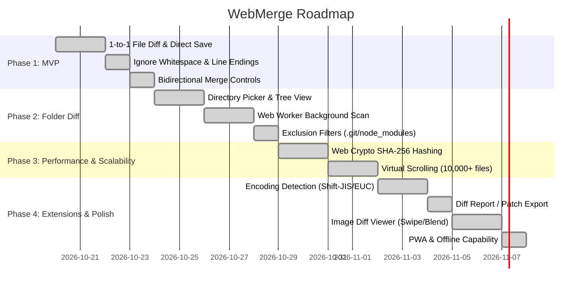

# WebMerge: Feasibility Study, Development Plan & Architecture Analysis

This document outlines the technical feasibility, phased roadmap, potential pitfalls, and architectural strategy for **WebMerge**—a browser-native, local-first file and folder diff/merge application.

---

## 1. Executive Summary

### Verdict: **Feasibility is Extremely High (Fully Viable)**
- **1-to-1 Text Diff, Merge & Direct In-Place Saving**: **Immediately achievable** using Monaco Editor and File System Access API.
- **Folder Comparison (Thousands of Files)**: **Viable for production** using Web Workers, WebAssembly (Rust), and on-demand file loading.
- **Zero Server Communication**: Operates 100% locally in the browser, making it completely secure for proprietary enterprise source code and configurations.

### Market Positioning & The Opportunity
1. **The Vacuum on macOS, Linux, and ChromeOS**:
   - While WinMerge dominates Windows, non-Windows platforms lack a free, high-performance, GUI-based folder diff tool. Users currently rely on expensive commercial tools (Beyond Compare) or limited editor diffs.
2. **Zero Installation & Zero Footprint**:
   - Requires no local environment setup or admin rights—simply open a URL in the browser.
3. **Enterprise Security Compliance**:
   - Works within restricted enterprise networks where installing third-party binaries is forbidden, but running an in-browser utility is permitted.
4. **The Advantage Over Legacy WinMerge**:
   - The original WinMerge project is burdened with 25+ years of C++ MFC/Win32 dependencies and strict GPL licensing, making a lightweight web port difficult for them. A modern greenfield web project fills this niche perfectly.

---

## 2. Technical Feasibility Study

### 2.1 Local File I/O (Read & Direct Overwrite)
| Capability | Technology | Browser Support | Feasibility |
| :--- | :--- | :--- | :--- |
| **Select & Read Single File** | `showOpenFilePicker()` or `<input type="file">` | All modern browsers | Excellent |
| **Recursive Directory Reading** | `showDirectoryPicker()` or `<input webkitdirectory>` | Chromium: Excellent Safari/Firefox: Fallback via input | Very High |
| **Direct File Overwrite** | `FileSystemFileHandle.createWritable()` | Chromium (Chrome/Edge): Native Safari/Firefox: Fallback to download | High |

> [!NOTE]
> Even on macOS, users running Google Chrome or Microsoft Edge enjoy direct file saving. For unsupported browsers, WebMerge gracefully falls back to direct blob downloads.

### 2.2 Diff & Editor Engine
- **Monaco Editor** is selected as the primary engine:
  - Battle-tested VS Code core editor.
  - Native side-by-side and inline diff editors.
  - Out-of-the-box syntax highlighting for 50+ languages.

### 2.3 High-Performance Folder Scanning
- **Web Workers**: Move all file discovery and hashing off the main thread to keep UI interaction smooth at 60 FPS.
- **WebAssembly (Rust)**: Utilize xxHash3 and fast Myers diff algorithms for multi-gigabyte directory comparison.
- **Lazy Loading**: Retain only lightweight file metadata in memory during directory scans. Full text is loaded strictly on-demand when clicked.

---

## 3. Potential Pitfalls & Mitigations

1. **System Protected Directories**:
   - Browsers prevent access to root paths (`C:\Windows`, downloads, etc.). WebMerge displays guidance and automatically excludes directories like `.git` and `node_modules`.
2. **External Modification Conflicts**:
   - Check file timestamps (`lastModified`) before saving. Alert the user if external tools (e.g. Git, IDE) have modified the file.
3. **Memory Pressure on Huge Files**:
   - Cap large text files and enforce on-demand memory loading.

---

## 4. Phased Development Roadmap

---

## 5. Testing & Quality Assurance Strategy

- **Unit Testing (Vitest)**: Core pure functions (`textNormalizer`, `diffMatcher`, `ignoreFilter`, `languageDetector`).
- **Worker & Integration Testing**: Worker messaging and state orchestration.
- **E2E Testing (Playwright)**: Full browser file interaction testing.
