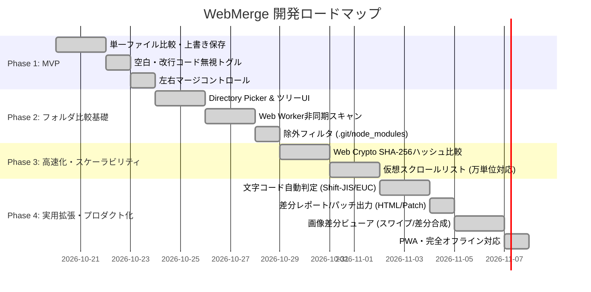

# Web版WinMerge（WebMerge）実現可能性調査・開発計画・課題分析書

本書は、ブラウザ内でローカル完結するファイル・フォルダ差分比較/マージツール（仮称: **WebMerge**）の実現可能性（Feasibility）、段階的な開発計画（Roadmap）、および想定される技術的課題・落とし穴（Pitfalls）と対策をまとめたドキュメントです。

---

## 1. エグゼクティブサマリー

### 結論: **実現可能性は「極めて高い（実用化可能）」**
- **1対1のテキスト比較・マージ・ローカル直接保存**: **即座に実現可能（1〜3日レベル）**。
- **フォルダ比較（数千ファイル規模）**: **アーキテクチャ設計次第で実用レベルに到達可能**（Web Workers + WebAssembly + 仮想スクロールの併用）。
- **完全ローカル処理（ゼロサーバー）**: 外部通信を一切行わないため、企業の機密コードや設定ファイルも安全に処理可能。

### なぜ今、Web版WinMergeなのか（勝機とポジショニング）
1. **Mac / Linux / Chromebook における「無料GUIフォルダ比較ツール」の空白地帯**:
   - WindowsではWinMergeが圧倒的デファクトですが、Macでは無料かつ高機能なフォルダ比較ツールが存在せず、有料（Beyond Compare等）かVS Codeの限定的な比較機能に依存しています。
2. **インストール不要・環境汚染ゼロ**:
   - 開発環境のセットアップが不要で、URLを開くだけで即利用可能。
3. **企業の厳しいセキュリティポリシーを突破**:
   - ソフトウェアの新規インストールが制限されているエンタープライズ環境でも、ブラウザさえあれば利用可能。
4. **本家WinMergeが動けない隙間**:
   - 本家WinMergeは25年以上のC++資産（Win32 API/MFC依存）とGPLライセンス、多すぎる機能の互換性維持が足かせとなり、Web版への軽量なリファクタリングが困難です。

---

## 2. 技術的実現可能性の検証（Feasibility Study）

### 2.1 ローカルファイル操作（読み込み & 上書き保存）
| 機能 | 技術 | ブラウザ対応状況 | 実現性 |
| :--- | :--- | :--- | :--- |
| **単一ファイルの選択・読み込み** | `showOpenFilePicker()` または `<input type="file">` | 全モダンブラウザ | ◎ 実装容易 |
| **フォルダ全体の読み込み** | `showDirectoryPicker()` または `<input webkitdirectory>` | Chromium系: ◎<br>Safari/Firefox: △（D&Dやinput経由のみ） | ◯ 実用可能 |
| **ローカルファイルへの直接上書き** | `FileSystemFileHandle.createWritable()` | Chromium系（Chrome/Edge）: ◎<br>Safari/Firefox: ✕（未サポート） | ◯ 対象ブラウザを定義すれば強力 |

> [!NOTE]
> SafariやFirefoxでは、セキュリティポリシーの違いからローカルファイルへの直接書き込み（File System Access API）が制限されています。
> ただし、Mac環境でも **Google Chrome や Microsoft Edge を使えば直接上書き保存が可能** です。非対応ブラウザに対しては「差分反映後のファイルをダウンロード保存（またはZIP一括保存）」というフォールバックを提供すれば全環境で成立します。

### 2.2 差分表示 & 編集エンジン
| エンジン | メリット | デメリット | 採用推奨度 |
| :--- | :--- | :--- | :--- |
| **Monaco Editor** (VS Codeのコア) | ・VS Codeと同じ操作感<br>・Diff Editorが標準搭載<br>・強力なシンタックスハイライト | ・バンドルサイズ大（10MB+）<br>・モバイルや極小画面に弱い | ★★★★★ (最優先) |
| **CodeMirror 6** | ・軽量・モジュール設計<br>・拡張性が極めて高い | ・DiffマージのUIを自前で組む工数がある | ★★★★☆ (代替候補) |
| **自作 (diff-match-patch等)** | ・完全な自由度 | ・車輪の再発明で工数が膨大 | ★☆☆☆☆ (非推奨) |

- **結論**: 初期フェーズは **Monaco Editor** の採用が最短かつ最もユーザー満足度が高くなります。

### 2.3 フォルダ比較の高速化（WebAssembly + Web Workers）
数千〜数万ファイルがあるフォルダの比較には、以下の2つの工夫が不可欠です。

1. **Web Workers (バックグラウンド並行処理)**:
   - ディレクトリの再帰スキャンとハッシュ計算を別スレッドで実行し、メインスレッド（UI描画）を一切カクつかせない。
2. **WebAssembly (Rust / C++)**:
   - **ハッシュ計算**: xxHash3 や fast-CRC32 をWasmで実行（JS比 3〜10倍高速）。
   - **テキスト比較**: Myers diff / LCS アルゴリズムをWasmで実行。
   - **メモリ管理**: 全ファイルの本文をメモリに載せず、ハッシュ値とメタデータ（サイズ・更新日時）のみをインデックス化することで、2GBのブラウザメモリ制限を回避。

### 2.4 文字コード（Shift-JIS / EUC-JP / UTF-8）の扱い
- 現代のブラウザは `TextDecoder` API をネイティブ搭載しており、**JavaScript標準で `Shift_JIS` や `EUC-JP` をデコード可能** です。
- エンコーディングの自動判別には、Rustの `chardetng`（Mozilla製）をWasm化して使うか、JSライブラリ（`encoding.js` / `jschardet`）を組み合わせることで、WinMerge同様の高精度な自動判定が可能です。

---

## 3. 想定される課題・落とし穴（Pitfalls）と具体的対策

### 課題 1: ブラウザセキュリティによるアクセス禁止ディレクトリ
- **事象**: `C:\Windows`、デスクトップ、ダウンロードフォルダ、`.git` ディレクトリなどに対しては、ブラウザがアクセスを拒絶または警告を出します。
- **対策**:
  - ユーザーが安全なサブフォルダを選択するようUI上でガイダンスを表示。
  - Git管理フォルダの場合は、`.git` を除外スキャンするフィルタをデフォルトで有効化。

### 課題 2: ファイルの外部更新・排他制御（ファイルロック）の不在
- **事象**: Web版でファイルを開いている最中に、VS CodeやGitなどの外部ツールで同ファイルが書き換えられた場合、ブラウザ側で検知・ロックできない。
- **対策**:
  - 保存直前にファイルの最終更新日時（`file.lastModified`）をチェック。
  - 開いた時点とタイムスタンプが異なっていれば、「外部で変更されています。上書きしますか？リロードしますか？」という警告ダイアログを出す（WinMerge本家と同様の挙動）。

### 課題 3: 大容量ファイル（100MB以上のログファイル等）のメモリ圧迫
- **事象**: Monaco Editorは数万行〜数十万行のテキストを展開するとメモリを大量消費し、タブがクラッシュ（OOM）する。
- **対策**:
  - ファイル比較の初期フェーズでは「ファイルサイズとハッシュ」のみで変更有無を判定。
  - テキスト差分エディタを開くのは「ユーザーがフォルダ一覧からファイルをクリックした瞬間」に限定（オンデマンド読み込み）。
  - 数十MB以上の巨大ファイルは「行単位の簡易Diff」または「先頭/末尾のみプレビュー」とする上限ガードを設ける。

### 課題 4: オープンソースライセンスの扱い
- **事象**: 本家WinMergeは **GPL-2.0** で公開されています。もし本家のC++コードを直接コピーしてWasm化した場合、本プロジェクト全体をGPL-2.0で公開する義務が生じます。
- **対策**:
  - 本家のコードを直接コピーするのではなく、**公開されているアルゴリズムや仕様（空白無視、改行無視、Myers diff等）を参考にしてフルスクラッチ（TypeScript + Rust）で実装** する。
  - これにより、より寛容な **MITライセンス または Apache-2.0** で公開でき、世界中の開発者がコントリビュートしやすくなります。

---

## 4. 段階的開発ロードマップ（Implementation Plan）



### Phase 1: MVP（単一ファイルの1対1比較・編集・保存）
- **ゴール**: 左右にファイルをD&D/選択し、差分を確認・編集して元のファイルに上書き保存できる。
- **実装内容**:
  - Vite + React / TypeScript + Tailwind CSS (またはVanilla CSS)。
  - `@monaco-editor/react` または Monaco Editor Vanilla によるDiffエディタ。
  - `showOpenFilePicker()` + `FileSystemFileHandle` による読み書き。
  - 基本設定: 「空白の違いを無視」「改行コード（CRLF/LF）の違いを無視」。

### Phase 2: フォルダ比較（数十〜数百ファイル規模）
- **ゴール**: 2つのフォルダを選択し、ファイル一覧のステータス（同一、変更あり、左のみ、右のみ）をビジュアル表示。
- **実装内容**:
  - `showDirectoryPicker()` による再帰的ファイルツリー探索。
  - Web Worker によるバックグラウンド走査（UIをフリーズさせない）。
  - 除外フィルタ機能（`.git`, `node_modules`, `dist`, `.DS_Store` 等）。
  - リストでファイルを選択すると、その場で左右のMonaco Diffエディタが開く2ペインUI。

### Phase 3: パフォーマンス最適化（数千ファイル対応）
- **ゴール**: 数千ファイルのプロジェクトフォルダを数秒で比較完了。
- **実装内容**:
  - Rust + `wasm-bindgen` による高速ハッシュ計算エンジン（xxHash3）。
  - ディレクトリツリーの仮想スクロール（`react-window` 等）によるDOM軽量化。
  - ハッシュ一致ファイルは本文読み込みをスキップするパイプライン処理。

### Phase 4: 実用拡張・プロダクト化
- **ゴール**: 本家WinMergeから乗り換えても不満のない機能拡充。
- **実装内容**:
  - Shift-JIS / EUC-JP 等のレガシー文字コード自動判定。
  - 画像差分（オニオンスキン、サイドバイサイド、スライダー比較）。
  - PWA（Progressive Web App）化によるデスクトップアプリアイコン登録・オフライン完全動作。
  - 差分レポート（HTML/Patch形式）のエクスポート。

---

## 5. 推奨アーキテクチャ設計

```mermaid
graph TD
    User([ユーザー]) -->|D&D / Picker| UI[メイン画面 UI (React + CSS)]
    
    subgraph MainThread [メインスレッド (ブラウザ)]
        UI --> Editor[Monaco Diff Editor (テキストマージ)]
        UI --> TreeView[仮想スクロール ディレクトリツリー]
        UI --> State[状態管理 (比較オプション / 差分メタデータ)]
    end

    subgraph WorkerThread [Web Worker (バックグラウンド)]
        Scanner[ディレクトリ再帰スキャナ]
        WasmEngine[Rust / Wasm コア]
        Scanner -->|Chunked Data| WasmEngine
        WasmEngine -->|xxHash3 / Fast Diff| Hasher[差分判定結果]
    end

    subgraph NativeFS [ローカルファイルシステム]
        FSA[File System Access API]
    end

    UI <==>|PostMessage (非同期通信)| WorkerThread
    Scanner <-->|FileHandle| FSA
    Editor <-->|直接上書き / 保存| FSA
```

### アーキテクチャの要点
1. **メインスレッドの防衛**:
   - ディレクトリ走査・ファイル読み取り・ハッシュ比較はすべて **Web Worker** に委任し、進捗（%）のみをメインスレッドに通知。
2. **オンデマンド読み込み（Lazy Loading）**:
   - 初期スキャンでは「ファイル名・サイズ・ハッシュ」のみ取得。Monaco Editorに流し込むテキスト本文は、ユーザーがツリー上の行をクリックした時のみ読み込む。
3. **ステートレス＆ゼロサーバー**:
   - サーバーサイドは静的ホスティング（GitHub Pages / Cloudflare Pages / Vercel）のみで、ランニングコストは完全無料。

---

## 6. テスト自動化・品質保証戦略（Testing Strategy）

WebMergeは「Web Worker」「WebAssembly (Rust)」「JavaScript/TypeScript」「File System Access API」が連携する高度なアーキテクチャを持ちます。開発中およびリファクタリング時の破綻を防ぐため、**Phase 1（初期立ち上げ）からテスト環境を整備し、TDD（テスト駆動開発）を並行して推進**します。

### 6.1 3層のテストレイヤー
| レイヤー | 対象領域 | 推奨ツール | 導入フェーズ | 検証ポイント |
| :--- | :--- | :--- | :--- | :--- |
| **1. 単体テスト (Unit)** | ・テキスト正規化<br>・差分アルゴリズム<br>・ハッシュ計算<br>・文字コード判定 | **Vitest** (JS/TS)<br>**cargo test** (Rust) | **Phase 1 (最初期)** | ・改行（CRLF/LF）や空白無視ロジックの正確性<br>・LCS/Myers diffの境界値テスト<br>・純粋関数としての入出力保証 |
| **2. 統合・通信テスト** | ・メインスレッド ⇔ Web Worker 通信 | **Vitest** (Worker Mocking) | **Phase 2** | ・数千ファイルのハッシュ計算要求と進捗（%）通知<br>・Workerクラッシュ時のエラーハンドリング |
| **3. E2Eテスト (ブラウザ操作)** | ・ファイルD&D<br>・Monaco Diff表示<br>・上書き保存 | **Playwright** | **Phase 1終盤〜Phase 2** | ・ユーザー操作シナリオの疎通<br>・パーミッション許可時のローカル保存確認 |

### 6.2 なぜテストの先行導入が不可欠か
1. **リファクタリング耐性の確保**:
   - 初期はTypeScriptで書いた比較ロジックを、後にRust/Wasmへ置き換える際、既存のテストケース（同じ入出力アサーション）を流用することで「速度改善に伴うバグ混入」をゼロにできます。
2. **UI非依存の爆速開発（Headless開発）**:
   - 「空白を無視する」「末尾改行の扱い」といったWinMerge特有の細かな仕様は、画面を都度手動操作しなくても、Vitestのウォッチモード（`npm test`）で瞬時に検証可能です。

---

## 7. 次のアクション（着手ステップの提案）

1. **ステップ 1: プロジェクト初期化 & テスト基盤立ち上げ**:
   - Gitリポジトリ初期化 & `.gitignore` 整備。
   - Vite + React + TypeScript + **Vitest** の雛形作成。
   - プロジェクト規約となる `AGENTS.md` の策定。
2. **ステップ 2: Phase 1 MVP開発**:
   - テスト駆動でテキスト正規化（空白・改行無視）ユーティリティを実装。
   - Monaco Diff Editor と File System Access API を統合し、1対1の比較・編集・保存を実現。
3. **ステップ 3: Phase 2 フォルダ比較 & Web Worker連携**:
   - `showDirectoryPicker()` によるファイルツリー探索。
   - WorkerスキャンとUI進捗バーの実装。

